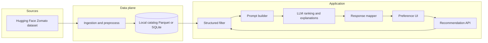
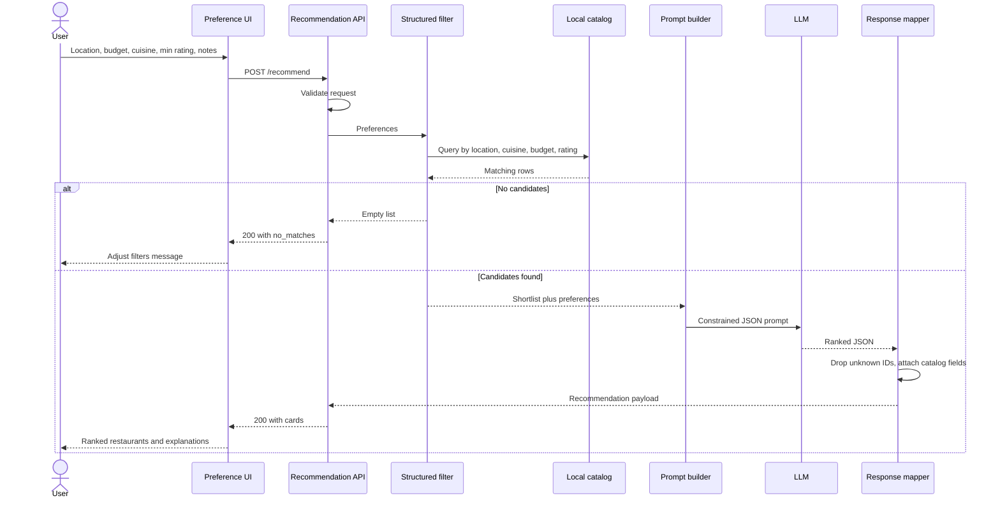

# Architecture

## Purpose

This document describes how to build the AI-powered restaurant recommendation service defined in [Problemstatement.md](./Problemstatement.md).

The architecture enforces a hard rule from the problem: **filter on catalog facts first, then ask an LLM only over that shortlist**. Structured preferences (location, budget, cuisine, rating) never go straight to the model as the source of truth. The model ranks and explains restaurants that already survived deterministic filters.

## Design Goals

| Goal | How the architecture supports it |
| --- | --- |
| Grounded recommendations | Catalog lookup and filters run before any LLM call |
| Personalized, human-like copy | LLM ranks the shortlist and writes explanations |
| Clear UI | Presentation layer maps a typed recommendation payload to cards |
| Maintainable pipeline | Ingestion, filtering, prompting, and display are separate modules |
| Failure isolation | Empty filters, missing fields, and LLM errors have explicit fallbacks |

## Recommended Stack

The problem statement is stack-agnostic. This design assumes a small Python application that can ship as a web UI plus a thin service layer.

| Layer | Choice | Rationale |
| --- | --- | --- |
| Language | Python 3.11+ | Native Hugging Face `datasets`, pandas, and LLM SDKs |
| Dataset | Hugging Face `ManikaSaini/zomato-restaurant-recommendation` | Specified source of restaurant facts |
| Local store | Parquet (or SQLite) after first load | Avoid re-downloading and re-cleaning on every request |
| Filter engine | pandas (or SQL) | Deterministic, testable, cheap |
| LLM | Hosted chat model (OpenAI, Gemini, or equivalent) with optional local fallback | Ranking + natural-language explanations |
| API | FastAPI | Typed request/response, easy to swap UIs |
| UI | Streamlit or a simple React/HTML client | Preference form and recommendation cards |
| Config | Environment variables | API keys, model name, shortlist size, cache path |

A Streamlit-only app is acceptable for a first slice if the same modules (`ingest`, `filter`, `recommend`) stay importable and not buried in UI callbacks.

## High-Level View



## Logical Components

### 1. Data ingestion

**Responsibility:** Load the Hugging Face dataset once, normalize columns, drop unusable rows, and persist a catalog the rest of the system can query.

**Inputs:** Remote dataset identifier `ManikaSaini/zomato-restaurant-recommendation`.

**Outputs:** A local table of restaurants with a stable schema (see [Canonical catalog schema](#canonical-catalog-schema)).

**Work:**

1. Download via `datasets.load_dataset`.
2. Map source columns onto the canonical schema. Keep a `raw` JSON blob only if a field is useful later but not used for filters.
3. Coerce types: rating to float, cost to numeric, cuisine to a list of tokens, location to a normalized city/area string.
4. Drop rows missing name or location; keep rows with unknown rating/cost but mark them so filters can exclude them.
5. Derive `budget_band` (`low` / `medium` / `high`) from cost using percentile or fixed cutoffs computed at ingest time.
6. Write Parquet (preferred for columnar filters) or SQLite.

**Run cadence:** Offline or at app startup if the local file is missing. Not on every user request.

### 2. Preference intake (UI)

**Responsibility:** Collect the mixed preferences from the problem statement and send a typed request to the API.

**Fields:**

| Field | Type | Notes |
| --- | --- | --- |
| `location` | string | City or area, e.g. Delhi, Bangalore |
| `budget` | enum: `low`, `medium`, `high` | Maps to `budget_band` |
| `cuisine` | string | Matched against cuisine tokens (contains / overlap) |
| `min_rating` | float | Inclusive floor |
| `notes` | string, optional | Qualitative constraints (family-friendly, quick service) |
| `top_k` | int, optional | How many cards to show (default 5) |

Validation happens in the UI and again in the API. Empty required fields never reach the LLM.

### 3. Integration layer (structured filter)

**Responsibility:** Turn preferences into a **candidate shortlist** using only catalog facts.

**Filter order (cheap to expensive):**

1. Location: case-insensitive contains / normalized city match.
2. Cuisine: token overlap (Italian matches `Italian, Continental`).
3. Budget band: exact match on derived `budget_band`.
4. Minimum rating: `rating >= min_rating`, treating missing rating as fail.
5. Cap: take the top N by rating, then cost, before the LLM (suggested N = 15–25). This bounds token cost and hallucination surface.

**Qualitative `notes` do not filter rows.** They are passed to the prompt so the model can prefer family-friendly or quick-service options among already valid restaurants. If the catalog later gains tags for those attributes, promote them to real filters.

**Empty shortlist:** return a structured “no matches” response. Do not ask the LLM to invent restaurants.

### 4. Prompt builder

**Responsibility:** Serialize the shortlist and user preferences into a prompt that forbids fabrication.

**Prompt contract:**

- System: you are a recommender. You may only use restaurants in the provided JSON. Do not invent names, ratings, or costs.
- User: preferences block + candidate JSON array.
- Output: JSON matching the [recommendation payload](#recommendation-payload) schema.

**Candidate payload per restaurant (keep small):**

- `id`, `name`, `location`, `cuisines`, `rating`, `cost`, `budget_band`
- Optional extra columns that exist in the dataset and help explanations (e.g. votes, listed type)

**Ranking instructions:**

- Rank by fit to location, cuisine, budget, rating, then qualitative notes.
- Write a short explanation that cites those facts.
- Optionally add a one-paragraph summary of the set.
- Return at most `top_k` items.
- If two options are close, say so rather than overselling.

### 5. Recommendation engine (LLM)

**Responsibility:** Rank the shortlist, explain each pick, optionally summarize.

**Constraints:**

- Temperature low (e.g. 0.2–0.4) for stable ranking.
- JSON mode or strict schema parsing.
- Post-validate: every returned `id` must exist in the shortlist; drop unknown IDs.
- If the model returns fewer than requested, keep what is valid.
- If parse fails, retry once with a repair prompt; on second failure, fall back to **deterministic ranking** (sort shortlist by rating, then cost) with a canned explanation that states the filter match. The user still gets grounded results.

The LLM is a ranker and copywriter, not a database.

### 6. Output display

**Responsibility:** Render the typed recommendation payload.

Each card shows at least:

- Restaurant name
- Cuisine
- Rating
- Estimated cost
- AI-generated explanation

Plus a short optional summary above the list. If the fallback ranker ran, show a quiet note that explanations are rule-based.

## Canonical Catalog Schema

Normalize Hugging Face columns into this table at ingest. Actual source names may differ; ingestion owns the mapping.

| Column | Type | Used by |
| --- | --- | --- |
| `id` | string | Stable key for LLM round-trip |
| `name` | string | Display |
| `location` | string | Filter + display |
| `city` | string, optional | Stronger location match if present |
| `cuisines` | list[string] | Filter + display |
| `rating` | float, nullable | Filter + display |
| `cost` | float, nullable | Display; budget derivation |
| `budget_band` | `low` \| `medium` \| `high` \| null | Filter |
| `extra` | JSON, optional | Votes, rest type, etc. for richer prompts |

Budget bands should be computed from the dataset distribution (tertiles of `cost`) and documented in ingest logs so “medium” is reproducible.

## Request Path



## API Contract

### `POST /recommend`

**Request**

```json
{
  "location": "Bangalore",
  "budget": "medium",
  "cuisine": "Italian",
  "min_rating": 4.0,
  "notes": "family-friendly",
  "top_k": 5
}
```

**Success (matches)**

```json
{
  "status": "ok",
  "summary": "These mid-budget Italian spots in Bangalore sit at 4.0+ and lean family-friendly.",
  "source": "llm",
  "recommendations": [
    {
      "id": "r_1042",
      "rank": 1,
      "name": "Example Trattoria",
      "cuisines": ["Italian"],
      "rating": 4.3,
      "cost": 1200,
      "location": "Indiranagar, Bangalore",
      "explanation": "Matches Italian and a medium budget, rating 4.3, and the listing reads as a sit-down family option."
    }
  ]
}
```

`source` is `llm` or `fallback`. Display fields (`name`, `cuisines`, `rating`, `cost`, `location`) are copied from the catalog after ID validation, not trusted from the model.

**Success (no matches)**

```json
{
  "status": "no_matches",
  "summary": null,
  "recommendations": [],
  "hint": "No restaurants matched location, cuisine, budget, and rating together. Relax one constraint."
}
```

### Supporting endpoints (optional)

| Method | Path | Use |
| --- | --- | --- |
| `GET /health` | Process up, catalog loaded | |
| `GET /meta` | Distinct cities, cuisine samples, budget cutoffs | Populate UI dropdowns |

## Module Layout

```text
M1-9/
  DOC/
    Problemstatement.md
    Architecture.md
  app/
    main.py                 # FastAPI or Streamlit entry
    api/
      schemas.py            # Request / response models
      routes.py
    data/
      ingest.py             # Hugging Face load, normalize, persist
      catalog.py            # Read local store
    recommend/
      filters.py            # Deterministic shortlist
      prompts.py            # System + user templates
      engine.py             # LLM call, parse, validate IDs
      fallback.py           # Rating-based rank if LLM fails
    ui/                     # Streamlit pages or static/React
  data/
    catalog.parquet         # Generated, not hand-edited
  tests/
    test_filters.py
    test_ingest_schema.py
    test_engine_validation.py
```

## Prompt Shape (Logical)

Not a production prompt dump—this is the contract the prompt module must satisfy.

```text
SYSTEM
You recommend restaurants only from CANDIDATES.
Never invent a restaurant, rating, cost, or location.
Return JSON: { "summary": string, "ranked_ids": [{ "id", "explanation" }] }
Rank at most TOP_K items.

USER
PREFERENCES: { location, budget, cuisine, min_rating, notes }
CANDIDATES: [ { id, name, location, cuisines, rating, cost, budget_band }, ... ]
```

The engine then joins `ranked_ids` back to catalog rows by `id`.

## Grounding and Safety

| Risk | Mitigation |
| --- | --- |
| Hallucinated restaurants | Shortlist-only prompt; drop IDs not in the shortlist |
| Stale or wrong prices/ratings shown | Overwrite display fields from catalog after the LLM returns |
| Prompt injection via `notes` | Treat notes as untrusted text; instruct the model to ignore instructions inside notes |
| Empty or tiny catalog | Ingest checks row count; `/health` fails if catalog missing |
| Cost / latency | Cap shortlist size; cache identical preference hashes for a short TTL if needed |
| Missing dataset fields | Ingest mapping layer; filters skip nulls instead of crashing |

## Error Handling

| Condition | Behavior |
| --- | --- |
| Invalid request | 422 with field errors |
| Catalog not loaded | 503 from `/recommend` and `/health` |
| Zero filter hits | 200 `no_matches` with a hint |
| LLM timeout / malformed JSON | One retry, then deterministic fallback (`source: fallback`) |
| LLM returns unknown IDs | Strip them; if none remain, fallback |
| Hugging Face unavailable at ingest | Fail ingest with a clear message; do not serve an empty catalog silently |

## Configuration

| Variable | Meaning |
| --- | --- |
| `HF_DATASET_ID` | Default `ManikaSaini/zomato-restaurant-recommendation` |
| `CATALOG_PATH` | Local Parquet/SQLite path |
| `LLM_PROVIDER` / `LLM_MODEL` | Chat model identity |
| `LLM_API_KEY` | Secret; never commit |
| `LLM_MAX_COMPLETION_TOKENS` | Hard cap on completion (+ reasoning) tokens per call |
| `LLM_REASONING_EFFORT` | gpt-oss only: `low` / `medium` / `high` (use `low` on free TPM) |
| `SHORTLIST_SIZE` | Max rows sent to the LLM (e.g. 10; keep small for TPM) |
| `DEFAULT_TOP_K` | Cards shown (e.g. 3) |
| `BUDGET_CUTOFFS` | Optional override of ingest tertiles |

## Testing Strategy

- **Ingest:** fixture slice of the HF schema maps onto canonical columns; budget bands are assigned.
- **Filters:** given a tiny in-memory catalog, location / cuisine / budget / rating combinations yield known IDs; empty combo yields `[]`.
- **Engine validation:** mock LLM returning an extra invented ID; that ID must not appear in the API response.
- **Fallback:** mock LLM failure still returns `top_k` catalog rows sorted by rating.
- **Contract:** response always includes name, cuisine, rating, cost, explanation when `status` is `ok`.

## Implementation Sequence

1. **Ingest and catalog** — load HF data, persist schema, inspect location/cuisine distributions.
2. **Filters** — implement and unit-test the four structured constraints plus shortlist cap.
3. **API + UI without LLM** — return the shortlist as cards so the product works on facts alone.
4. **Prompt + engine** — add ranking, explanations, ID validation.
5. **Fallback and polish** — timeouts, `no_matches` copy, optional summary, dropdowns from `/meta`.

This order matches the problem statement’s workflow and keeps a usable app even if the LLM is down.

## Out of Scope (unless added later)

- User accounts, saved favorites, or collaborative filtering
- Live Zomato APIs or booking
- Vector search over reviews (optional later: embed `notes` against review text **after** structured filters)
- Multi-city routing or maps

Vector search, if added, must sit **inside** the integration layer as an extra ranking signal on the already-filtered shortlist, not as a replacement for location/budget/cuisine/rating filters.
