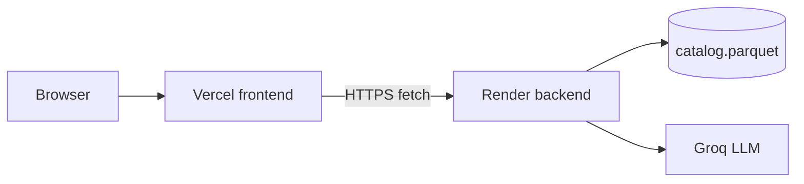

# Deployment plan — Frontend (Vercel) + Backend (Render)

## Target hosts

| Layer | Platform | Ships |
| --- | --- | --- |
| **Frontend** | [Vercel](https://vercel.com) | Static PlateMatch UI from `app/ui/web/` |
| **Backend** | [Render](https://render.com) | FastAPI API (`/health`, `/meta`, `/recommend`) + Parquet catalog + Groq |



Today one `uvicorn` process serves both UI and API from `app/main.py`. Relative `fetch("/meta")` / `fetch("/recommend")` only work when they share an origin. Splitting hosts requires:

1. A configurable **API base URL** in the frontend (points at Render).
2. **CORS** on the backend (allows the Vercel origin).

---

## Current constraints (read before deploying)

1. **No CORS middleware** — browser calls from Vercel to Render will fail until CORS is added.
2. **Hardcoded same-origin API calls** in `app/ui/web/assets/app.js` (`fetch("/meta")`, `fetch("/recommend")`).
3. **Catalog is gitignored** (`data/*.parquet`). Local file is ~1.3 MB / ~52k rows. Render must receive a catalog via Docker build context, build step, or disk — otherwise `/health` returns 503.
4. **Secrets** live only in `.env` locally. Never commit `LLM_API_KEY` / `GROQ_API_KEY`.
5. **Ingest is heavy** (`datasets` + Hugging Face). Prefer baking `catalog.parquet` into the Render image over re-downloading on every cold start.
6. **Streamlit UI** (`app/ui/streamlit_app.py`) is out of scope for Vercel.
7. **Render free Web Services spin down** after idle time. First request after sleep can take 30–60s+; keep frontend loading timeouts generous.

---

## Phase 0 — Code changes before first deploy

Required in the repo before either host will work together.

### 0.1 Backend (Render): CORS

Allow the Vercel frontend origin(s) only.

```env
CORS_ORIGINS=https://your-app.vercel.app,http://localhost:3000
```

Register FastAPI `CORSMiddleware` with those origins, methods `GET, POST, OPTIONS`, headers `*`.

### 0.2 Frontend (Vercel): configurable API base URL

```js
const API_BASE = window.__API_BASE__ || "";
```

Use `${API_BASE}/meta` and `${API_BASE}/recommend`. Inject `__API_BASE__` from an inline script in `index.html`, or generate `assets/config.js` at build time from a Vercel env var.

| Environment | `API_BASE` value |
| --- | --- |
| Local (UI + API same origin) | `""` |
| Production | `https://<service>.onrender.com` (no trailing slash) |

### 0.3 Optional: API-only mode on Render

Keep mounting `/` and `/assets` for local demo, or gate with `SERVE_UI=false` on Render so production backend is API-only. Not required if Vercel is the public frontend.

### 0.4 Catalog packaging for Render (pick one)

| Option | Pros | Cons |
| --- | --- | --- |
| **A. Docker `COPY data/catalog.parquet`** | Fast boot, no HF at runtime | Rebuild when catalog changes; file must exist in build context |
| **B. Build command runs ingest** | Fresh catalog | Slow builds; needs HF + larger deps |
| **C. Persistent Disk + one-time ingest** | Survives redeploys | Not on free tier; more ops |

**Recommended:** Option A.

### 0.5 Lean production deps for Render

Render does not need `streamlit`, `pytest`, or `datasets` if the catalog is prebuilt. Use `requirements.prod.txt` with: `fastapi`, `uvicorn[standard]`, `pandas`, `pyarrow`, `httpx`, `pydantic`, `python-dotenv`, `groq`.

---

## Phase 1 — Backend on Render

### 1.1 Prerequisites

- Render account linked to this Git repo.
- Groq API key (optional — without it, `/recommend` still returns `source: fallback`).
- Local `data/catalog.parquet` from `python -m app.data.ingest`.

### 1.2 Create a Web Service

Use a **Web Service** (not Static Site — Static Site cannot run FastAPI).

| Setting | Value |
| --- | --- |
| Runtime | Docker (recommended) or Python |
| Region | Closest to users |
| Instance | Free for demos; Starter+ for no spin-down |
| Health Check Path | `/health` |

### 1.3 Suggested Dockerfile

```dockerfile
FROM python:3.12-slim
WORKDIR /app

COPY requirements.prod.txt .
RUN pip install --no-cache-dir -r requirements.prod.txt

COPY app ./app
COPY data/catalog.parquet ./data/catalog.parquet

ENV CATALOG_PATH=data/catalog.parquet
ENV PYTHONUNBUFFERED=1

# Render sets PORT; default 8000 for local docker runs
CMD uvicorn app.main:app --host 0.0.0.0 --port ${PORT:-8000}
```

Notes:

- Bind `0.0.0.0` and use Render’s `PORT`. No `--reload` in production.
- `data/*.parquet` is gitignored — ensure the file is present in the Docker build context (local build, CI artifact, or private download in `Dockerfile`).

### 1.4 Native Python alternative (no Docker)

| Field | Example |
| --- | --- |
| Build Command | `pip install -r requirements.prod.txt` (+ place catalog) |
| Start Command | `uvicorn app.main:app --host 0.0.0.0 --port $PORT` |

### 1.5 Optional `render.yaml`

```yaml
services:
  - type: web
    name: platematch-api
    runtime: docker
    plan: free
    healthCheckPath: /health
    envVars:
      - key: CATALOG_PATH
        value: data/catalog.parquet
      - key: LLM_PROVIDER
        value: groq
      - key: LLM_MODEL
        value: openai/gpt-oss-120b
      - key: LLM_TEMPERATURE
        value: "0.3"
      - key: LLM_MAX_COMPLETION_TOKENS
        value: "350"
      - key: LLM_REASONING_EFFORT
        value: low
      - key: SHORTLIST_SIZE
        value: "10"
      - key: DEFAULT_TOP_K
        value: "3"
      - key: CACHE_TTL_SECONDS
        value: "300"
      - key: LLM_API_KEY
        sync: false
      - key: CORS_ORIGINS
        sync: false
```

Set `LLM_API_KEY` and `CORS_ORIGINS` in the Render dashboard.

### 1.6 Backend environment variables (Render)

| Variable | Required | Notes |
| --- | --- | --- |
| `LLM_API_KEY` | Recommended | Groq key (`gsk_...`) |
| `LLM_PROVIDER` | No | `groq` |
| `LLM_MODEL` | No | e.g. `openai/gpt-oss-120b` |
| `LLM_TEMPERATURE` | No | `0.3` |
| `LLM_MAX_COMPLETION_TOKENS` | No | `350` |
| `LLM_REASONING_EFFORT` | No | `low` on free tier |
| `SHORTLIST_SIZE` | No | `10` |
| `DEFAULT_TOP_K` | No | `3` |
| `CACHE_TTL_SECONDS` | No | `300` |
| `CATALOG_PATH` | If not default | `data/catalog.parquet` |
| `CORS_ORIGINS` | **Yes** once Vercel URL exists | `https://<project>.vercel.app` |
| `SERVE_UI` | Optional | `false` if API-only mode is implemented |

### 1.7 Backend checklist

1. Deploy → public URL `https://<name>.onrender.com`.
2. `GET /health` → `{"status":"ok","catalog_loaded":true}`.
3. `GET /meta` → locations/cuisines present.
4. `POST /recommend` (Banashankari / medium / Italian / min_rating 4.0) → cards with `source: llm` or `fallback`.
5. On free tier, confirm wake-up after idle works (expect cold-start delay).

### 1.8 Backend ops notes

- Free tier spin-down: frontend loading state must cover wake + Groq latency.
- Keep Groq calls lean so Render request timeouts are not hit.
- Ephemeral disk by default — bake the catalog into the image.
- Enable auto-deploy on push to `main` for backend changes.

---

## Phase 2 — Frontend on Vercel

### 2.1 What to publish

Contents of `app/ui/web/`:

```text
index.html
assets/app.css
assets/app.js
assets/config.js   # if generated (API base URL → Render)
```

### 2.2 Vercel project setup

1. New Vercel project → import the same Git repo.
2. **Root Directory:** `app/ui/web` (simplest), **or** repo root with a copy-to-`dist` build.
3. **Framework Preset:** Other / static.
4. **Build:** empty if Root Directory is `app/ui/web`; otherwise generate config + copy files to `dist/`.
5. **Production env:**

   | Variable | Value |
   | --- | --- |
   | `API_BASE` (or whatever the inject script reads) | `https://<service>.onrender.com` |

### 2.3 Optional `vercel.json`

```json
{
  "outputDirectory": "dist",
  "headers": [
    {
      "source": "/assets/(.*)",
      "headers": [{ "key": "Cache-Control", "value": "public, max-age=31536000, immutable" }]
    }
  ]
}
```

Prefer **browser → Render directly + CORS**. Vercel rewrites to Render are optional (same-origin proxy) and need path changes (`/api/meta`, etc.).

### 2.4 Frontend checklist

1. Open `https://<project>.vercel.app`.
2. Form loads dropdowns from Render `/meta` (cross-origin in Network tab).
3. Submit → cards render; no CORS errors.
4. Tight filters still show empty state.
5. After Render sleep, first submit may be slow — keep loading UI visible.
6. For preview deploys, add matching preview origins to Render `CORS_ORIGINS` or set preview `API_BASE`.

---

## Phase 3 — Wire Frontend ↔ Backend

1. Deploy **backend on Render** → note `https://….onrender.com`.
2. Set Vercel `API_BASE` to that URL → deploy **frontend**.
3. Set Render `CORS_ORIGINS` to the Vercel URL (plus localhost if needed).
4. Redeploy Render if CORS is loaded only at process start.
5. End-to-end smoke test from the Vercel URL.

Custom domains (optional):

1. Vercel domain for frontend; Render custom domain for backend (e.g. `api.yourdomain.com`).
2. Update `API_BASE` and `CORS_ORIGINS` to those hosts.
3. Confirm HTTPS on both.

---

## Phase 4 — Verification matrix

| Test | Expect |
| --- | --- |
| Render `/health` | 200, catalog loaded |
| Render `/meta` | Bangalore-centric locations/cuisines |
| Render `/recommend` happy path | 200, cards, valid catalog IDs |
| Render `/recommend` tight filters | `no_matches` + hint |
| Render without LLM key | 200, `source: fallback` |
| Render after idle (free) | Wakes; eventual 200 on `/health` |
| Vercel UI load | HTML/CSS/JS 200 |
| Vercel → Render CORS | No browser CORS block |
| Mobile viewport | Form + cards usable |

Demo prefs: Banashankari, medium budget, Italian, min rating 4.0, notes “family-friendly”.

---

## Phase 5 — Ongoing releases (optional)

| Trigger | Action |
| --- | --- |
| Push affecting `app/**` (backend) | Render auto-deploy |
| Push affecting `app/ui/web/**` (frontend) | Vercel auto-deploy |
| Catalog refresh | Re-ingest locally → rebuild Render image |
| Secret rotation | Update Render env vars only |

---

## Out of scope

- Streamlit on Vercel.
- Hugging Face download on every Render request.
- Committing `.env` or API keys.
- Rewriting the UI in React/Next — static PlateMatch is enough for Vercel.
- Treating Render free tier as an always-on SLA.

---

## Implementation backlog

1. [x] Backend: `CORS_ORIGINS` + `CORSMiddleware`.
2. [x] Frontend: parameterized API base URL (inject from Vercel env).
3. [x] Backend: `requirements.prod.txt` + `Dockerfile` with baked `data/catalog.parquet`.
4. [ ] Deploy backend on Render; verify `/health` + `/recommend`.
5. [ ] Deploy frontend on Vercel with `API_BASE` → Render URL.
6. [ ] Set Render `CORS_ORIGINS` to Vercel origin; end-to-end smoke test.
7. [x] (Optional) Custom domains; `SERVE_UI=false` on Render. (`SERVE_UI` supported; custom domains still manual.)
8. [ ] (Optional) Paid Render plan if cold starts are unacceptable.

---

## Rollback

- **Frontend:** revert Vercel deployment; backend unaffected.
- **Backend:** redeploy previous Render deploy; use `/health` as the gate.
- **Bad catalog:** roll back the Render image that last had a good `catalog.parquet`.

---

## Summary

**Frontend on Vercel** serves the static PlateMatch UI. **Backend on Render** runs FastAPI with a baked-in Parquet catalog and Groq credentials. Before deploy, add CORS and a configurable API base URL. Wire Vercel → Render over HTTPS, then smoke-test. On Render free tier, expect spin-down wake latency on the first request.
